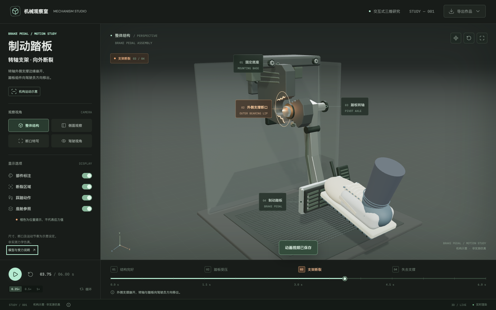

# Brake Pedal Studio

Interactive Three.js illustration of a brake pedal bearing support breaking outward toward the driver. The assembly, fracture surface and six-second motion are illustrative, not measured engineering data.



## Run

```sh
npm ci
npm run dev
```

Open http://localhost:5188. `npm run build` generates the production bundle. With the server running, `npm run verify` checks rendering, controls and animated exports. Install a browser with `npx playwright install chromium` if needed.

## Model

- The upper mount and rear bearing support remain fixed. The outer bearing lip separates toward the driver, followed by the axle and pedal settling downward. The pedal arm remains intact.
- In this assumed geometry, the pushrod connection lies between the pivot and the foot contact. The pushrod reaction can exceed the opposing foot force because its lever arm is shorter, producing an outward load on the pivot support. This explains the chosen motion direction, not a measured failure load or cause.
- Model coordinates use +Y up and +Z toward the driver. Fragments initially travel toward +Z. Dimensions, displacement, material appearance and timing are visual assumptions.
- Four cameras, reversible timeline, slow playback, component visibility and exploded view are available. The orange outline marks the fracture location; it does not encode stress.

## Files

- [Animated GLB](public/exports/brake-pedal-animated.glb): editable assembly, six seconds at 30 samples per second.
- [Blender project](public/exports/brake-pedal.blend): imported animation, camera, lighting and timeline markers.
- [MP4](public/exports/brake-pedal.mp4): 1440 x 810, 24 fps, six seconds.
- [WebM](public/exports/brake-pedal.webm): browser recording.

GLB and current-view PNG/WebM can also be exported directly from the application.

## Regenerate Media

With the development server running:

```sh
npm run verify
node scripts/render-video.mjs
ffmpeg -y -framerate 24 -i artifacts/frames/%04d.png -c:v libx264 -crf 19 -pix_fmt yuv420p -movflags +faststart public/exports/brake-pedal.mp4
blender --background --factory-startup --python scripts/prepare_blend.py -- public/exports/brake-pedal-animated.glb public/exports/brake-pedal.blend
```

`PLAYWRIGHT_CHROMIUM_EXECUTABLE` can specify an installed Chromium. Browser checks use Metal on macOS and SwiftShader elsewhere; `STUDY_ANGLE` overrides the renderer. `STUDY_URL` overrides the development URL.
